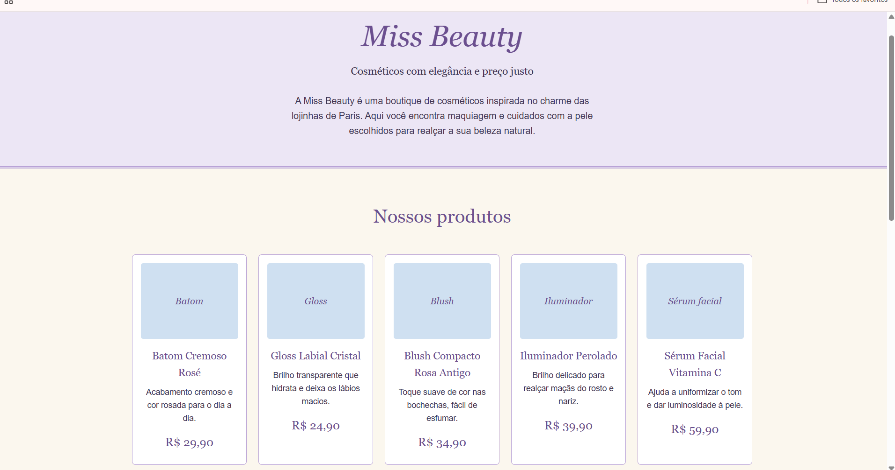

# Miss Beauty — Simulador de Compras

**Aluna:** Kethelyn Reis Sousa
**Trilha:** Desenvolvimento Mobile
**Desafio 1:** Minha Loja — Simulador de Compras

## Captura de tela

## Sobre a Miss Beauty

A Miss Beauty é uma loja fictícia de cosméticos e produtos de beleza, criada para o desafio de simulador de compras.

A identidade visual foi pensada com base nos meus gostos pessoais, utilizando uma combinação de lilás, lavanda, creme e branco, com detalhes em amarelo suave e azul pastel. A proposta é transmitir uma aparência delicada e minimalista.

## Objetivo do simulador

Simular uma compra usando apenas JavaScript básico: o programa pergunta a quantidade de cada produto com `prompt()`, calcula os valores, verifica o direito ao desconto e mostra o resumo com `alert()`. A página em si é apenas apresentação (HTML e CSS), sem interatividade extra.

## Produtos e preços

| Produto | Preço |
|---|---|
| Batom Cremoso Rosé | R$ 29,90 |
| Gloss Labial Cristal | R$ 24,90 |
| Blush Compacto Rosa Antigo | R$ 34,90 |
| Iluminador Perolado | R$ 39,90 |
| Sérum Facial Vitamina C | R$ 59,90 |
| Lápis de Olho Preto | R$ 14,90 |
| Contorno em Bastão | R$ 37,90 |
| Paleta de Sombras Lavanda | R$ 49,90 |
| Pó Facial Translúcido | R$ 32,90 |
| Água Micelar 200 ml | R$ 27,90 |

Os produtos e preços são fictícios. A página não usa fotos: cada produto tem um espaço reservado com o nome da categoria.

## Tecnologias utilizadas

- HTML
- CSS
- JavaScript

## Como executar

1. Baixe ou clone este repositório.
2. Mantenha `index.html`, `style.css`, `script.js` e a pasta `assets` juntos.
3. Dê dois cliques no `index.html` para abri-lo no navegador.
4. Clique em **Simular compra** e responda às caixas que aparecerem.

Não é necessário instalar nada.

## Como o simulador funciona

1. Ao clicar no botão, o atributo `onclick` chama a função `simularCompra()`.
2. Para cada produto, um `prompt()` pergunta a quantidade e `Number()` converte a resposta em número.
3. Digitar `0` significa não comprar o produto. Deixar em branco ou clicar em Cancelar também conta como 0.
4. Depois das 10 perguntas, o programa confere se alguma quantidade é inválida (letras, número negativo ou decimal). Se for, mostra um aviso e encerra.
5. O subtotal é a soma de preço × quantidade de cada produto.
6. Se o subtotal for zero, aparece o aviso "Nenhum produto foi selecionado."
7. Um `alert()` final mostra os produtos escolhidos, quantidades, valores, subtotal, desconto e total final.

## Regra do desconto

**7% de desconto em compras a partir de R$ 270,00, exclusivamente para pagamento via Pix.**

- Subtotal igual ou superior a R$ 270,00: o programa pergunta a forma de pagamento. Se a resposta for `Pix` (também aceita `pix` e `PIX`), aplica 7%; qualquer outra resposta fica sem desconto.
- Subtotal inferior a R$ 270,00: não há desconto e a forma de pagamento não é perguntada.

## Testes realizados

A ordem das perguntas é a da tabela de produtos (do Batom até a Água Micelar). Nos testes com "demais = 0", respondi 0 para todos os outros produtos.

| # | Cenário | Entradas | Resultado esperado | Resultado obtido | Status |
|---|---|---|---|---|---|
| 1 | Compra simples, sem desconto | Batom = 1, demais = 0 | Subtotal e total R$ 29,90 | Batom: 1 un., R$ 29,90. Subtotal R$ 29,90, desconto R$ 0,00, total R$ 29,90 | OK |
| 2 | Vários produtos | Gloss = 2, Lápis = 3, demais = 0 | Gloss R$ 49,80; Lápis R$ 44,70; total R$ 94,50 | Gloss R$ 49,80 e Lápis R$ 44,70. Subtotal R$ 94,50, desconto R$ 0,00, total R$ 94,50 | OK |
| 3 | Tudo zero | Todos = 0 | "Nenhum produto foi selecionado." | Apareceu "Nenhum produto foi selecionado." | OK |
| 4 | Quantidade negativa | Batom = -1, demais = 0 | Aviso de valor inválido ao final das perguntas | Apareceu o aviso de valor inválido | OK |
| 5 | Texto no lugar de número | Batom = abc, demais = 0 | Aviso de valor inválido | Apareceu o aviso de valor inválido | OK |
| 6 | Quantidade decimal | Batom = 1.5, demais = 0 | Aviso de valor inválido | Apareceu o aviso de valor inválido | OK |
| 7 | Logo abaixo do limite | Blush = 1, Sérum = 2, Lápis = 1, Paleta = 2, demais = 0 | Subtotal R$ 269,40; sem pergunta de pagamento; sem desconto | Blush R$ 34,90; Sérum R$ 119,80; Lápis R$ 14,90; Paleta R$ 99,80. Subtotal R$ 269,40, desconto R$ 0,00, total R$ 269,40 | OK |
| 8 | Acima do limite com Pix | Batom = 10, demais = 0; pagamento: Pix | Subtotal R$ 299,00; desconto R$ 20,93; total R$ 278,07 | Batom: 10 un., R$ 299,00. Subtotal R$ 299,00, desconto R$ 20,93, total R$ 278,07 (teste repetido) | OK |
| 9 | Acima do limite sem Pix | Batom = 10, demais = 0; pagamento: Cartão | Desconto R$ 0,00; total R$ 299,00 | Batom: 10 un., R$ 299,00. Subtotal R$ 299,00, desconto R$ 0,00, total R$ 299,00 | OK |

## Uso de inteligência artificial

O Claude, assistente de inteligência artificial, foi utilizado como ferramenta de apoio durante o desenvolvimento do projeto. Consultei a ferramenta para tirar dúvidas, receber orientações sobre o código HTML, CSS e JavaScript e ajudar a resolver problemas que surgiram durante a implementação.

Também utilizei o Claude para revisar e simplificar e o código, além de receber orientações sobre alguns comandos. As decisões sobre a loja, a identidade visual, os produtos, os preços e a regra de desconto foram definidas por mim. Procurei manter o projeto dentro do meu nível atual de conhecimento, sem utilizar recursos que ainda não estudei ou compreendi.

Os testes registrados neste README foram executados por mim no navegador

### Adaptações que eu fiz

Procurei desenvolver o projeto dentro do meu nível atual de conhecimento, que ainda é iniciante. Durante a implementação, precisei tomar decisões sobre a identidade visual da loja, os produtos que seriam apresentados, os preços e as regras do simulador.

Na escolha dos produtos, optei por não colocar muitas opções, para que a simulação das compras não ficasse muito longa ou complicada, já que o programa pergunta a quantidade de cada produto individualmente.

### Como verifiquei o resultado

Executei os 9 cenários de teste e repeti as verificações para conferir se os resultados estavam corretos.

O teste 8 foi repetido mais vezes porque, na primeira tentativa, achei que o simulador não tinha funcionado como esperado. Depois, percebi que talvez eu mesma tivesse me confundido na hora de escolher a forma de pagamento.

Também conferi os valores dos produtos, o total da compra e a aplicação do desconto de 7% para pagamentos via Pix, quando a compra atingia o valor mínimo de R$ 270,00.

Os testes me ajudaram a verificar se o simulador estava seguindo as regras que defini para a loja.

## Dificuldades e aprendizados

Mesmo sendo um projeto simples, tive algumas dificuldades durante o desenvolvimento, principalmente porque ainda estou aprendendo JavaScript e como utilizar essa linguagem junto com outras ferramentas.

Também tive dificuldades para fazer algumas funções funcionarem como esperado e compreender alguns trechos do código. Outra parte que ainda estou aprendendo é a utilização do Git e do GitHub, desde os comandos até a organização e publicação do projeto.

O desenvolvimento foi uma oportunidade de praticar o que venho estudando, conhecer melhor o funcionamento de HTML, CSS e JavaScript e aprender um pouco mais sobre como essas tecnologias podem ser utilizadas juntas.

O desenvolvimento foi uma oportunidade de praticar o que venho estudando, conhecer melhor o funcionamento de HTML, CSS e JavaScript e aprender um pouco mais sobre como essas tecnologias podem ser utilizadas juntas.
